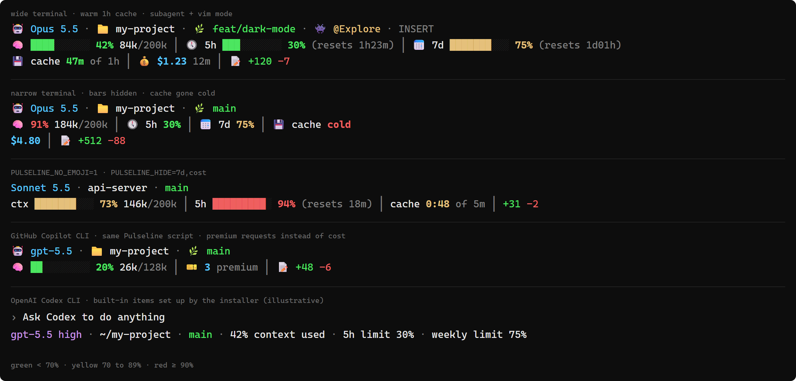

# Pulseline

[English](../README.md) · [Português](README.pt-BR.md) · [Español](README.es.md) · **日本語** · [简体中文](README.zh-CN.md) · [한국어](README.ko.md)

Pulseline は、ターミナルで使う AI コーディングツール向けのカラフルなステータスラインです。モデル、フォルダ、git ブランチ、コンテキストウィンドウがどれくらい埋まっているか、使用量の上限をどれだけ使ったか、プロンプトキャッシュがいつ切れるか、セッションにかかったコスト、変更した行数を表示します。表示はターミナルの幅に合わせて変わります。

| ツール | 対応状況 |
|---|---|
| [Claude Code](https://claude.com/claude-code) | 完全対応。Pulseline のスクリプトを実行します。 |
| [GitHub Copilot CLI](https://github.com/github/copilot-cli) | Pulseline のスクリプトを実行します。カスタムステータスラインは、Copilot ではまだ実験的な機能です。 |
| [OpenAI Codex CLI](https://github.com/openai/codex) | Codex はカスタムスクリプトを実行できないので、インストーラーが一番近い組み込み項目を有効にします。 |


<sub>上から順に：広いターミナルの Claude Code、狭いターミナルの Claude Code、<code>PULSELINE_NO_EMOJI</code> + <code>PULSELINE_HIDE</code> 使用時、GitHub Copilot CLI、OpenAI Codex CLI。<a href="../assets/pulseline-preview.svg">ベクター版 (SVG)</a></sub>

## 表示される内容

| セグメント | 表示内容 |
|---|---|
| 🤖 モデル · 📁 フォルダ · 🌿 ブランチ | 現在のモデル、作業フォルダ、git ブランチ |
| 👾 `@agent` · `INSERT` | 動作中のサブエージェントと vim モード (Claude Code で使っているとき) |
| 🧠 コンテキスト | コンテキストウィンドウの使用量。バー、パーセント、`used/total` のトークン数で表示します |
| 🕔 5h · 📅 7d | Claude サブスクリプションの上限と、それぞれがリセットされるまでの時間 |
| 💾 キャッシュ | プロンプトキャッシュが切れるまでの時間。切れた後は `cold · 73k to rewrite` と表示します |
| 💰 コスト | セッションにかかった金額 (USD) と、セッションの経過時間 |
| 🎫 premium | セッションで使ったプレミアムリクエスト数 (Copilot CLI) |
| 📝 +/- | このセッションで追加・削除した行数 |

数値は 70% 未満なら緑、70〜89% なら黄色、90% 以上なら赤になります。

ウィンドウが狭くなると、セグメントは次の行に回ります。2 行でも収まらないときは、まずバーを、次にリセット時刻を隠します。

ツールが報告しない情報 (たとえば API キーを使っているときのレート制限) があれば、そのセグメントは表示されません。

まったく同じ出力をする 2 つの版があります。`pulseline.py` は Python 3 だけで動き、`pulseline.sh` には bash と jq が必要です。

## かんたんインストール

インストーラーは Claude Code、Copilot CLI、Codex CLI を探して、見つかったものを教えてくれます。スクリプトを `~/.pulseline/` (Windows では `C:\Users\<you>\.pulseline\`) に置き、各ツールにステータスラインの設定を追加します。ほかの設定には手を付けません。

ファイルを変更する前に、その隣にコピー (`settings.json.bak-<date>`) を保存します。ファイルが正しい JSON でなければ、そのファイルには触れません。何度でも実行し直せます。設定を二重に追加することはなく、同じ設定を更新します。

### Windows

一番かんたんなのは、プロジェクトをダウンロードして ([Code → Download ZIP](https://github.com/leealvescosta/pulseline/archive/refs/heads/main.zip))、展開し、`install-windows.cmd` をダブルクリックする方法です。

PowerShell に次を貼り付けても大丈夫です。

```powershell
irm https://raw.githubusercontent.com/leealvescosta/pulseline/main/install.ps1 | iex
```

Python 3 が入っていなければ、インストーラーが `winget` でのインストールを提案します。

### macOS

一番かんたんなのは、ZIP をダウンロードして展開し、`install-macos.command` をダブルクリックする方法です。初回は macOS にブロックされることがあります。そのときはファイルを右クリックして **Open** を選び、もう一度 **Open** を押してください。

ターミナルに次を貼り付けても大丈夫です。

```bash
curl -fsSL https://raw.githubusercontent.com/leealvescosta/pulseline/main/install.sh | bash
```

### Linux

```bash
curl -fsSL https://raw.githubusercontent.com/leealvescosta/pulseline/main/install.sh | bash
```

終わったら Claude Code、Copilot CLI、Codex を再起動してください。ターミナルの下にステータスラインが表示されます。

## 手動インストール

### 編集する前に読んでください

ここで扱う設定ファイルはどれも JSON です。ちょっとしたミスでファイル全体が壊れたり、ツールが何も言わずにステータスラインを無視したりします。次の 4 点に気をつけてください。

1. `settings.json` には、たぶんすでに別の設定が入っています。ファイルの上から貼り付けるのではなく、`statusLine` ブロックをその隣に追加してください。
2. `statusLine` はトップレベル、つまり一番外側の `{ }` の直下に置く必要があります。`env`、`permissions`、`extraKnownMarketplaces` などの別のブロックの中に入ってしまうと動きません。
3. 項目の間にはカンマを入れますが、最後の項目の後には入れません。
4. 再起動する前にファイルを確認してください ([settings.json を確認する](#settingsjson-を確認する) を参照)。

よくあるミスの例です。`statusLine` ブロックが `extraKnownMarketplaces` の中に入ってしまっています。

```jsonc
{
  "extraKnownMarketplaces": {
    "my-plugins": { "source": { "source": "github", "repo": "me/plugins" } },
    "statusLine": {                       // ✗ 別のブロックの中
      "type": "command",
      "command": "python3 ~/.pulseline/pulseline.py"
    }
  }
}
```

こうなると Claude Code は `statusLine` をプラグインのマーケットプレイスだと思って無視し、次の警告を出します。

```
Invalid marketplace entry was ignored: source: Invalid input: expected object, received undefined
```

直すには、先に別のブロックを閉じてから、同じ階層に `statusLine` を追加します。

```jsonc
{
  "extraKnownMarketplaces": {
    "my-plugins": { "source": { "source": "github", "repo": "me/plugins" } }
  },                                      // ← extraKnownMarketplaces を閉じて、カンマ
  "statusLine": {                         // ✓ トップレベル
    "type": "command",
    "command": "python3 ~/.pulseline/pulseline.py"
  }
}
```

`//` のコメントは説明のためだけに書いています。JSON ではコメントが使えないので、実際のファイルには書かないでください。

### ステップ 1: スクリプトをコピーする

`~/.pulseline/` フォルダ (Windows では `C:\Users\<you>\.pulseline\`) を作り、その中に `pulseline.py` をコピーします。Python 3 はないけれど `bash` と `jq` はある、という場合は `pulseline.sh` を使ってください。

### ステップ 2: コマンドを選ぶ

| システム | `command` の値 |
|---|---|
| macOS / Linux, Python | `python3 ~/.pulseline/pulseline.py` |
| macOS / Linux, bash | `bash ~/.pulseline/pulseline.sh` |
| Windows, Python | `python C:/Users/<you>/.pulseline/pulseline.py` |

Windows でのちょっとしたコツです。

- スラッシュ (`C:/Users/...`) を使ってください。JSON ではバックスラッシュを二重にする必要があり (`C:\\Users\\...`)、つい忘れがちです。
- `~` は展開されない場所もあるので、`~` ではなくフルパスを書いてください。
- パスにスペースが含まれる場合は、文字列の中でパスを引用符で囲みます: `"\"C:/Program Files/Python312/python.exe\" C:/Users/<you>/.pulseline/pulseline.py"`。

### ステップ 3a: Claude Code

`~/.claude/settings.json` (Windows では `C:\Users\<you>\.claude\settings.json`) を開きます。ファイルがなければ、中身を `{}` にして作ってください。それから次を追加します。

```json
{
  "statusLine": {
    "type": "command",
    "command": "python3 ~/.pulseline/pulseline.py"
  }
}
```

### ステップ 3b: GitHub Copilot CLI

`~/.copilot/settings.json` (または `COPILOT_HOME` で指定したフォルダ) を開きます。Copilot のカスタムステータスラインはまだ実験的な機能なので、`STATUS_LINE` フィーチャーフラグも有効にする必要があります。

```json
{
  "statusLine": {
    "type": "command",
    "command": "python3 ~/.pulseline/pulseline.py"
  },
  "feature_flags": {
    "enabled": ["STATUS_LINE"]
  }
}
```

すでに `feature_flags.enabled` リストがある場合は、2 つ目を作らずに、そこに `"STATUS_LINE"` を追加してください。`copilot --experimental` で Copilot を起動するか、Copilot の中で `/experimental` を実行しても大丈夫です。Copilot はフラグを起動時に読み込むので、その後で再起動してください (`/restart`)。

### ステップ 3c: OpenAI Codex CLI

Codex はカスタムスクリプトを実行しませんが、`~/.codex/config.toml` で組み込み項目を有効にできます。このファイルは JSON ではなく TOML です。

```toml
[tui]
status_line = ["model-with-reasoning", "current-dir", "git-branch", "context-used", "five-hour-limit", "weekly-limit"]
```

ファイルにすでに `[tui]` セクションがある場合は、2 つ目の `[tui]` を追加せずに、その下に `status_line` の行を書いてください。Codex の中で `/statusline` を実行すれば、メニューから項目を選ぶこともできます。

### ステップ 4: 再起動して確認する

ツールを再起動します。ステータスラインが表示されないときは、[トラブルシューティング](#トラブルシューティング) を見てください。

### settings.json を確認する

再起動する前に、次を実行してください。ファイルが正しければ、その内容がそのまま表示されます。正しくなければ、問題のある行と列を教えてくれます。

```bash
python3 -m json.tool ~/.claude/settings.json            # macOS / Linux
```

```powershell
python -m json.tool $env:USERPROFILE\.claude\settings.json   # Windows
```

次に、`statusLine` がトップレベルにあるか確かめます。これを実行するとコマンドが表示されるはずです。`null` と表示されたら、ブロックが別の何かの中に入っています。

```bash
python3 -c "import json,os; print(json.load(open(os.path.expanduser('~/.claude/settings.json'))).get('statusLine'))"
```

## オプション

Pulseline はいくつかの環境変数を読み込みます。Claude Code の場合、一番かんたんな設定場所は `~/.claude/settings.json` の `env` ブロックです。これも `statusLine` と同じくトップレベルに置きます。

```json
{
  "env": {
    "PULSELINE_HIDE": "cost,7d",
    "PULSELINE_NO_EMOJI": "1"
  }
}
```

Copilot CLI の場合は、シェルのプロファイルで設定します。`~/.zshrc` や `~/.bashrc` に `export PULSELINE_HIDE=cost` と書くか、Windows なら `setx PULSELINE_HIDE cost` を実行してください。

| 変数 | 役割 |
|---|---|
| `PULSELINE_HIDE` | 指定したセグメントを隠します。カンマ区切りで書きます: `branch`, `agent`, `vim`, `ctx`, `5h`, `7d`, `cache`, `cost`, `premium`, `diff` |
| `PULSELINE_NO_EMOJI=1` | 絵文字の代わりにテキストラベル (`ctx`, `5h`, `cost`…) を表示します。絵文字を表示できないターミナルやフォント向けです |
| `PULSELINE_HOME` | インストーラーがスクリプトを置く場所を指定します (デフォルトは `~/.pulseline`) |
| `CLAUDE_CONFIG_DIR` / `COPILOT_HOME` / `CODEX_HOME` | ツールの設定を別の場所に移している場合に、その場所をインストーラーに教えます |

## キャッシュタイマーのしくみ

`💾 cache 47m of 1h` は、会話のプロンプトキャッシュが 1 時間の有効期間のうち、あと 47 分で切れるという意味です。残り時間が 20% を切ると数字が黄色になります。キャッシュが切れると赤い `cold` が表示され、次のメッセージでキャッシュに書き直す必要があるトークン数も一緒に出ます。

Claude Code はリクエストごとにキャッシュの有効期間を決めます。Claude サブスクリプションでプランの使用量の範囲内なら 1 時間です。追加使用量、API キー、クラウドプロバイダーを使っているとき、または `FORCE_PROMPT_CACHING_5M=1` や `promptCacheTtl: "5m"` を設定したときは 5 分です。5 分キャッシュへの書き込みは入力料金の 1.25 倍、1 時間キャッシュへの書き込みは 2 倍かかり、キャッシュからの読み込みは 0.1 倍以下です。詳しくは [How Claude Code uses prompt caching](https://code.claude.com/docs/en/prompt-caching#cache-lifetime) にあります。

Pulseline は Claude Code が送ってくる `prompt_cache` のデータ (バージョン 2.1.251 以降) を使います。それより古いバージョンでは、セッションのトランスクリプトからタイマーを推定します。このセグメントは Claude Code でだけ表示されます。

## トラブルシューティング

| 症状 | 対処法 |
|---|---|
| `Invalid marketplace entry was ignored ... statusLine` という警告が出る | `statusLine` が `extraKnownMarketplaces` の中に入っています。トップレベルに移してください ([上の例を参照](#編集する前に読んでください))。 |
| settings.json が不正だと言われる、または設定がすべて無視される | カンマか波かっこがずれています。[ファイルを確認する](#settingsjson-を確認する) と、問題の行がわかります。 |
| ステータスラインが表示されず、エラーも出ない | スクリプトを自分で実行してみてください: `echo '{}' \| python3 ~/.pulseline/pulseline.py`。2 行表示されるはずです。表示されるなら、`statusLine` が別のブロックの中に入っている可能性が高いので、トップレベルにあるか確認してください。 |
| Copilot CLI に何も表示されない | `STATUS_LINE` フィーチャーフラグが有効になっているか確認し (または `--experimental` で Copilot を起動し)、再起動してください。 |
| `jq: command not found` | `jq` をインストールするか、Python 版を使ってください。 |
| Windows で `python` を実行すると Microsoft Store が開く | [python.org](https://www.python.org/downloads/) から Python をインストールし、*Add python.exe to PATH* にチェックを入れてから、インストーラーをもう一度実行してください。 |
| 絵文字の代わりに四角が表示される | `PULSELINE_NO_EMOJI=1` を設定するか、絵文字に対応したフォントに切り替えてください。 |
| settings.json を壊してしまったので元に戻したい | インストーラーは実行するたびに、ファイルの隣に `settings.json.bak-<date>` のコピーを保存しています。 |

## アンインストール

1. `~/.claude/settings.json` と `~/.copilot/settings.json` の一方または両方から `statusLine` ブロックを削除します。Copilot では、ほかに必要としているものがなければ `feature_flags.enabled` から `STATUS_LINE` を外してもかまいません。
2. Codex では、`~/.codex/config.toml` から `status_line` の行を削除します。
3. `~/.pulseline/` フォルダを削除して、ツールを再起動します。

## ライセンス

[MIT](../LICENSE)
